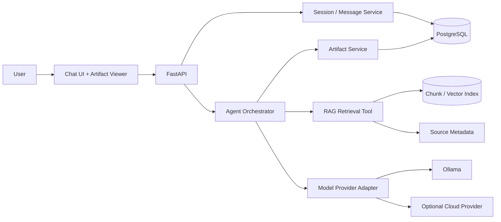

# Architecture and Design Decisions

## 1. Status and intent

This is the proposed architecture for the Lenny Growth Assistant assessment. The initial implementation should validate high-risk integrations early and evolve from a small vertical slice. Component names below describe responsibilities, not a claim that the code already exists.

## 2. System context



The API is the stable application boundary. The agent orchestrates tasks; retrieval supplies evidence; the provider adapter hides model-specific configuration; PostgreSQL persists sessions, messages, and artifact metadata.

## 3. Main components

### Frontend
Responsibilities:
- Render sessions, chat messages, loading/error states, source references, and provider selection.
- Display Markdown/HTML artifacts beside the conversation.
- Send session IDs and user messages to the API.
- Never treat model output or generated HTML as trusted application code.

### FastAPI application
Responsibilities:
- Validate request payloads and return predictable response schemas.
- Expose health, session, chat, provider-configuration, and artifact endpoints.
- Apply timeouts and map internal failures to safe API errors.
- Keep HTTP concerns separate from agent/retrieval logic.

Proposed endpoint surface (final paths may change as the implementation is built):
- `GET /health` — application liveness; dependency readiness may be reported separately.
- `POST /api/v1/sessions` — create a session.
- `GET /api/v1/sessions/{session_id}` — retrieve session metadata and history.
- `POST /api/v1/chat` — send a message in a session and receive an answer with sources.
- `GET /api/v1/providers` — return safe provider/model choices and current selection.
- `POST /api/v1/artifacts` or an agent tool — create an artifact from conversation context.
- `GET /api/v1/artifacts/{artifact_id}` — retrieve a persisted artifact.

Avoid exposing secrets through provider endpoints. Provider switching should be validated server-side.

### Session and persistence service
Responsibilities:
- Create and load sessions.
- Persist user and assistant messages with timestamps.
- Enforce session ownership/isolation at the service boundary.
- Persist artifact metadata/content as the artifact design requires.

Initial relational model:
- `users`: stable ID, optional metadata, created timestamp. If authentication is not implemented, document that user identity is demo-level and do not imply production authorization.
- `sessions`: ID, optional user ID, created timestamp, updated timestamp.
- `messages`: ID, session ID foreign key, role, content, created timestamp, optional safe metadata such as model/provider and source references.
- `artifacts`: ID, session ID foreign key, type, title, content or storage reference, created/updated timestamps.

Use migrations and foreign keys. Keep session history ordering deterministic. Do not log API keys or dump secrets into database metadata.

### Corpus ingestion
Responsibilities:
1. Load only sources the project is allowed to use.
2. Normalize extracted text while preserving source boundaries.
3. Split text into chunks suitable for retrieval.
4. Attach stable source IDs and metadata to every chunk.
5. Compute embeddings and store chunks in a searchable index.
6. Support repeatable refreshes and avoid duplicate chunks.

Source metadata should include as available: source ID, title, URL, source type (podcast/newsletter), episode or publication date, chunk index, and original locator. A citation should point back to the source, not merely expose an opaque vector ID.

The public repository should include ingestion code and setup instructions, not an unauthorized dump of copyrighted content.

### Retrieval service (RAG)
Responsibilities:
- Convert the user query (with relevant follow-up context) into a retrieval query.
- Retrieve candidate chunks.
- Optionally rerank candidates if evaluation shows a benefit and resource budget allows it.
- Return evidence passages plus stable source metadata and relevance information.
- Return an explicit empty/low-confidence result when evidence is insufficient.

Keep retrieval independent of model generation so it can be tested with known queries and expected source IDs. Do not let the answer generator silently manufacture source references.

### Agent orchestrator
Responsibilities:
- Receive the user task and relevant conversation context.
- Choose whether a retrieval or artifact tool is needed.
- Call tools using narrow, typed contracts.
- Use retrieved evidence to formulate a grounded response.
- Return a structured answer containing prose and source references.
- Route artifact-generation requests to the artifact workflow.

Avoid making the agent responsible for deterministic tasks such as input validation, database transaction handling, or health checks.

#### Pi integration decision
Pi Coding Agent is TypeScript-oriented while the required backend is FastAPI/Python. Before selecting it as the final runtime, run a minimal compatibility spike:
1. Configure Pi to use the local Ollama endpoint/model.
2. Send a prompt and confirm a successful model response.
3. Register one small retrieval tool and confirm tool invocation.
4. Confirm timeouts, errors, and structured results can cross the integration boundary.
5. Decide between a small TypeScript sidecar process and a Python-native orchestration alternative only if the assessment's framework requirement permits it.

Do not shell out to a coding agent with unrestricted host access for ordinary user chat. Any subprocess bridge must use argument-safe invocation, bounded timeouts, controlled working directories, and an explicit tool allowlist. The integration decision and failed attempts belong in the assessment's coding-agent transcript.

### Model provider adapter
Expose one internal interface for generation so callers do not need to know the provider's HTTP details. Configuration should identify provider, base URL where appropriate, model name, timeouts, and credentials via environment variables.

- **Local provider:** Ollama, with the selected model configured (initially testing Qwen2.5 3B and 7B).
- **Cloud provider:** optional adapter configured with an API key when available.
- **Switching:** allow a safe UI/config selection without source-code changes; validate the requested provider/model and report a clear error when unavailable.
- **Privacy:** never return credentials to the browser or include them in logs.

Keep provider routing deterministic and testable. The model should not decide whether a secret is exposed or which arbitrary endpoint receives it.

### Artifact service
- Accept a structured artifact request and return a typed artifact (Markdown or HTML).
- Persist artifact content or a storage reference and associate it with a session.
- For HTML, sanitize dangerous elements/attributes and render in a restrictive sandboxed iframe with a restrictive content security policy where possible.
- Prefer Markdown for simple documents; use HTML only when layout materially improves the result.
- Treat artifact content as untrusted even if generated by the assistant.

## 4. Suggested request flow

1. UI sends `session_id` and message to FastAPI.
2. API validates the request and confirms the session exists.
3. User message is persisted.
4. Orchestrator receives the message plus a bounded amount of relevant history.
5. If the task requires corpus knowledge, orchestrator calls retrieval.
6. Retrieval returns evidence and source metadata, or an explicit no-evidence result.
7. Provider adapter calls the selected model with the task instructions and evidence.
8. Application validates the structured result and source references.
9. Assistant response and metadata are persisted.
10. API returns the answer, sources, session ID, and any artifact metadata.
11. UI renders the answer and source links; artifacts render in the isolated viewer.

A failure before step 9 should not create a fake successful assistant response. Where practical, persist a safe error/status event for debugging without leaking credentials.

## 5. API contract sketch

Example request:

```json
{
  "session_id": "uuid",
  "message": "What are common mistakes in early-stage growth?"
}
```

Example response:

```json
{
  "session_id": "uuid",
  "message_id": "uuid",
  "answer": "The retrieved sources suggest ...",
  "sources": [
    {
      "source_id": "source-123",
      "title": "Example episode title",
      "url": "https://example.com/source",
      "chunk_id": "chunk-456"
    }
  ],
  "provider": {
    "name": "ollama",
    "model": "configured-model"
  }
}
```

These are illustrative contracts, not implemented schemas. Do not include a source in the response unless it was actually retrieved and used.

## 6. Configuration

A future `.env.example` should document safe placeholders for settings such as:
- `APP_ENV`
- `DATABASE_URL`
- `OLLAMA_BASE_URL`
- `OLLAMA_MODEL`
- `LLM_PROVIDER`
- cloud provider model and API key variable (placeholder only)
- request/model timeouts
- retrieval top-k and chunking parameters

Do not commit real `.env` files or secrets. Provide defaults only where safe and predictable.

## 7. Reliability and observability

- Add request and session correlation IDs to structured logs where practical.
- Configure bounded model and database timeouts.
- Distinguish application liveness from dependency readiness.
- Return actionable errors for Ollama offline, model missing, provider key missing, DB unavailable, empty retrieval, and malformed model output.
- Avoid retry loops that multiply latency; retry only transient failures with a small bound.
- Log operational metadata, not credentials or unnecessary private content.

## 8. Testing strategy

### Unit tests
- Chunking preserves source metadata.
- Retrieval returns expected source IDs for a small deterministic fixture.
- Empty retrieval is represented explicitly.
- Provider adapter routes to the selected backend and handles unavailable providers.
- Source references in a response must be drawn from retrieved evidence.
- HTML sanitizer rejects scripts, event handlers, and unsafe URLs.

### API/integration tests
- Session creation and history retrieval.
- Message persistence and stable ordering.
- Session isolation.
- Chat request validation and safe error mapping.
- Health behavior with and without dependencies.
- Artifact persistence and retrieval.
- Provider configuration cannot expose credentials.

### Manual UI test plan
- Empty state and first message.
- Multi-turn follow-up in the same session.
- Two sessions with no cross-contamination.
- Sources are visible and open the correct target.
- Unsupported question receives an honest response.
- Switch local/cloud provider; missing key and offline Ollama states are understandable.
- Long answer and long artifact layout.
- Malicious HTML fixture cannot execute scripts or escape the viewer.
- Refresh/reopen a session and confirm history persists.

## 9. Architecture decisions and trade-offs

| Decision | Rationale | Trade-off / validation |
| --- | --- | --- |
| FastAPI as the HTTP boundary | Required backend and clear typed API | Keep long-running model work bounded and observable. |
| PostgreSQL for durable sessions | Relational integrity and queryable history | Requires migrations and a running database. |
| Separate retrieval from orchestration | Easier to test grounding and replace components | More explicit interfaces to maintain. |
| Provider adapter | Model can be switched without rewriting application logic | Providers still differ in structured output and timeout behavior. |
| Validate Pi/Ollama early | Reduces risk around a required integration | May need a sidecar process because Pi and API runtimes differ. |
| Isolated artifact rendering | Generated HTML is untrusted | Some advanced HTML behavior may be intentionally restricted. |

## 10. Open questions to resolve during implementation

- Which licensed/accessible transcript source and ingestion format will be used for the demo?
- Which vector store or database extension is available in the target environment?
- Does the Pi/Ollama compatibility spike pass with the local model and retrieval tool?
- What authentication/session ownership guarantees are expected for the assessment demo?
- Should artifact content be stored directly in PostgreSQL or as files with metadata in PostgreSQL?
- What context length and retrieval settings provide the best quality within available laptop memory?
